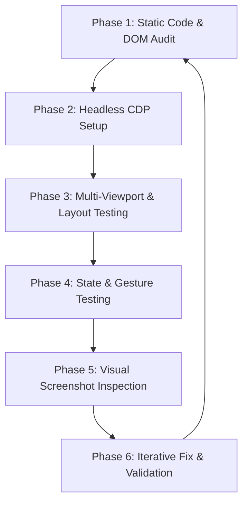

# Continuous QA & Visual Defect Auditor

This skill provides an autonomous, repeatable methodology to uncover hidden bugs, audit visual layouts across viewports, simulate user interactions, and verify fixes without regressions.

---

## 6-Phase Autonomous Quality Cycle



---

### Phase 1: Static Code & DOM Audit
1. **HTML Structure**:
   - Check for unclosed tags, malformed container hierarchies, and duplicate IDs.
   - Verify keyboard accessibility (`role`, `tabindex="0"`, `aria-expanded`, `aria-sort`, `aria-label`).
2. **JavaScript Logic**:
   - Inspect data pipeline edge cases (empty states, missing properties, `null`/`undefined` fallbacks).
   - Ensure event listeners are attached only once or cleaned up on dynamic re-renders.
   - Verify cross-view consistency (e.g., table columns, formatters, and card layouts matching between query modes).
3. **CSS & Responsive Rules**:
   - Check media queries: mobile portrait (`max-width: 640px` / `390px`), mobile landscape (`max-height: 520px`), tablet (`768px`), and desktop (`1440px`).
   - Identify horizontal overflow culprits (`min-width` without responsive wrapper, unconstrained flex children).

---

### Phase 2: Headless CDP Setup
Always test against the live development server using headless Chromium via standard WebSocket CDP:

1. **Launch Chromium**:
   ```bash
   chromium-browser \
     --headless=new \
     --no-sandbox \
     --disable-gpu \
     --remote-debugging-port=9227 \
     --user-data-dir=/tmp/chrome-test-cdp \
     about:blank
   ```
2. **Connect WebSocket**:
   - Query `http://127.0.0.1:9227/json` for `webSocketDebuggerUrl`.
   - Enable `Page`, `Runtime`, and `Emulation` domains.
3. **Session Fixture**:
   - Navigate with test parameters (e.g. `?preview=testuser`) to ensure deterministic initial state.
   - Poll readiness via `Runtime.evaluate` checking both DOM elements and non-empty table/card data.

Use the reusable helper script at [scripts/cdp_test_runner.js](./scripts/cdp_test_runner.js).

---

### Phase 3: Multi-Viewport Auditing
Run test passes across four standard device metrics:

| Viewport Name | Width x Height | Device Scale | Mode | Focus Area |
| :--- | :--- | :--- | :--- | :--- |
| **Desktop** | 1440 x 900 | 1.0 | Standard | Full workbench, dense tables, toolbar alignment |
| **Tablet** | 768 x 1024 | 1.0 | Portrait | Collapsed sidebars, grid wrap, modal max-width |
| **Mobile Portrait** | 390 x 844 | 2.0 | Mobile touch | Touch target sizes (>=44px), sticky headers, overflow-x |
| **Mobile Landscape** | 844 x 390 | 2.0 | Mobile touch | Vertical scrolling, modal max-height, compact toolbars |

Set metrics via CDP:
```javascript
await send('Emulation.setDeviceMetricsOverride', {
    width: 390,
    height: 844,
    deviceScaleFactor: 2,
    mobile: true
});
```

---

### Phase 4: State & Gesture Testing
Simulate real user sequences through `Runtime.evaluate`:
1. **Inputs & Form Controls**:
   - Dispatch `input` and `change` events with `bubbles: true`.
   - Verify autocomplete popovers, keyboard navigation, and dismiss buttons.
2. **Interactive Toggles & Accordions**:
   - Click accordion arrows and row containers; verify `aria-expanded="true"` and `display: table-row`.
   - Verify row expansion remains functional after dynamic sorting, pagination, or query execution.
3. **Modal Dialogs**:
   - Verify modal opens with `.showModal()`, traps focus, and has working close controls.
   - Audit action buttons inside modals to ensure deprecated or broken endpoints are absent.

Always wrap multi-step evaluations in IIFEs (`(() => { ... })()`) to avoid variable redeclaration conflicts in the global evaluation scope.

---

### Phase 5: Visual Screenshot Inspection
1. Scroll target containers into view before taking screenshots:
   ```javascript
   container.scrollIntoView({ behavior: 'instant', block: 'start' });
   ```
2. Capture screenshots via `Page.captureScreenshot`:
   - Save to artifact directory.
   - Use `view_file` to visually examine the captured image for clipped text, unaligned icons, awkward line wraps, or contrast defects.

---

### Phase 6: Iterative Fix & Validation Cycle
1. **Fix Root Causes**: Make minimal, robust edits addressing the core issue, avoiding superficial workarounds.
2. **Run Targeted CDP Assertion**: Re-execute the CDP test script to assert that the bug is resolved and no regressions were introduced.
3. **Commit Cleanly**: Commit with standard conventional commit messages referencing the affected components and rationale.
