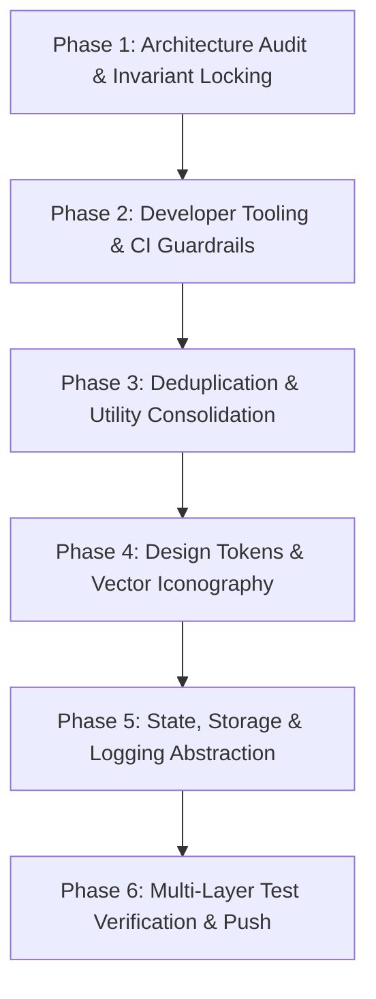

# No-Build Static Web App Modernizer

This skill provides a systematic, zero-regression runbook for modernizing vanilla JavaScript, HTML, and CSS web applications. It transforms legacy or loosely-structured static sites into maintainable, open-source-ready codebases while preserving a pure **no-build** deployment model (deployable straight from git to GitHub Pages, Netlify, or static servers).

---

## The 6-Phase Modernization Workflow



---

### Phase 1: Architecture Audit & Invariant Locking

1. **Verify No-Build Invariants**:
   - Ensure the application continues to run directly in the browser via standard ES modules (`<script type="module">`).
   - Avoid mandatory bundlers (Vite, Webpack, Rollup) in the production build artifact unless explicitly requested by the user.
   - Separate **developer-only tooling** (linting, formatting, testing) from **runtime dependencies**.

2. **Branching Discipline**:
   - Never perform invasive multi-step refactors directly on `main` or `master`.
   - Create a clean feature branch: `git checkout -b refactor/modernization-and-tooling`.
   - Commit incrementally after each phase with conventional commit messages (`build:`, `refactor:`, `style:`, `docs:`, `test:`).

---

### Phase 2: Developer Tooling & CI Guardrails

Establish code hygiene and automated testing before making structural edits:

1. **`package.json` Setup**:
   - Mark `"type": "module"` and `"private": true`.
   - Add lightweight development scripts:
     ```json
     {
       "scripts": {
         "dev": "npx --yes http-server . -p 8000 -c-1",
         "lint": "eslint js tests",
         "lint:css": "stylelint \"css/**/*.css\"",
         "format": "prettier --check \"{js,css,tests}/**/*.{js,css}\" \"*.html\"",
         "format:fix": "prettier --write \"{js,css,tests}/**/*.{js,css}\" \"*.html\"",
         "test": "vitest run"
       }
     }
     ```
2. **ESLint 9 Flat Config (`eslint.config.js`)**:
   - Configure ES modules, browser and node globals, without forcing module resolution plugins that break vanilla relative paths.
3. **Automated CI Workflows (`.github/workflows/ci.yml`)**:
   - Run linter, CSS validator, Prettier check, and Vitest suite on every push and pull request.
4. **Contributor Guidelines**:
   - Add `CONTRIBUTING.md` documenting local setup, code conventions, pull request process, and architecture principles.

---

### Phase 3: Deduplication & Utility Consolidation

1. **Identify Forked / Duplicate Code**:
   - Search for duplicate pages, copied CSS files, or parallel implementations (e.g. `insights.html` vs `wrapped.html`).
   - Remove dead branches or replace secondary duplicate pages with thin redirects.
2. **Consolidate Common Utilities**:
   - Unify scattered helper functions (e.g., `escapeHtml`, string formatters, time calculators) into single canonical modules (`js/utils/format.js`).
   - Ensure all user-sourced data (e.g., usernames, notes, comments) passes through `escapeHtml()` prior to DOM insertion.

---

### Phase 4: Design Tokens & Vector Iconography

1. **Unified Design Tokens (`css/tokens.css`)**:
   - Declare shared CSS custom properties on `:root`:
     - Color scales: `--bg-primary`, `--bg-surface`, `--text-primary`, `--text-muted`, `--border-subtle`, `--accent-primary`.
     - Spacing & Radius: `--radius-sm`, `--radius-md`, `--radius-lg`, `--space-2`, `--space-4`.
     - Typography: `--font-sans`, `--font-mono`.
   - Link `css/tokens.css` across all HTML entry points to guarantee visual consistency.
2. **Vector Icon Standardization**:
   - Replace emoji-based UI controls and telemetry badges with crisp, accessible inline SVGs or shared SVG symbols.
   - Standardize icon sizes (`16x16` for inline badges, `18x18` for nav tabs) with `currentColor` stroke/fill.

---

### Phase 5: State, Storage & Logging Abstraction

1. **Typed Storage Registry (`js/storage/storage.js`)**:
   - Prevent magic strings for `localStorage` and `sessionStorage` keys.
   - Handle private browsing, iframe restrictions, and corrupted JSON storage gracefully using memory fallbacks.
   ```javascript
   export const STORAGE_KEYS = Object.freeze({
       TOKEN: 'tw_token',
       AUTH_METHOD: 'tw_auth_method',
       FETCH_STOPOVERS: 'tw_fetch_stopovers',
       FILTER_LEVEL: 'tw_filter_level'
   });

   export const Storage = {
       get(key, fallback = null) { /* safe getItem with fallback */ },
       set(key, value) { /* safe setItem */ },
       getJSON(key, fallback = null) { /* safe JSON.parse with fallback */ },
       setJSON(key, value) { /* safe JSON.stringify */ },
       remove(key) { /* safe removeItem */ }
   };
   ```
2. **Leveled Logger (`js/utils/logger.js`)**:
   - Replace unstructured `console.log` statements with a controllable logger.
   - Automatically activate `DEBUG` mode when `?debug=1` is present in the query string.

---

### Phase 6: Multi-Layer Test Verification

Verify changes across three testing tiers before declaring completion:

1. **Unit Tests (Vitest)**:
   - Run `npm test` covering pure logic, parsers, SQL engines, formatters, and storage abstractions.
2. **Static Linting**:
   - Run `npm run lint` and ensure 0 errors.
3. **Headless Chrome DevTools Protocol (CDP) E2E Test**:
   - Spawn headless Chromium connecting via WebSocket to the live local dev server (`http://127.0.0.1:8000`).
   - Test critical edge cases:
     - Malformed queries / syntax error recovery.
     - State invariants during sorting, filtering, and tab switching.
     - Deep-linking URL resolution (`?trip=...` / `#map=...`).
     - Extreme viewports (iPhone SE 320px portrait, 844x390 landscape modal fits).
4. **Push to Feature Branch**:
   - Push verified commits to the remote branch and present a clean diff summary.
