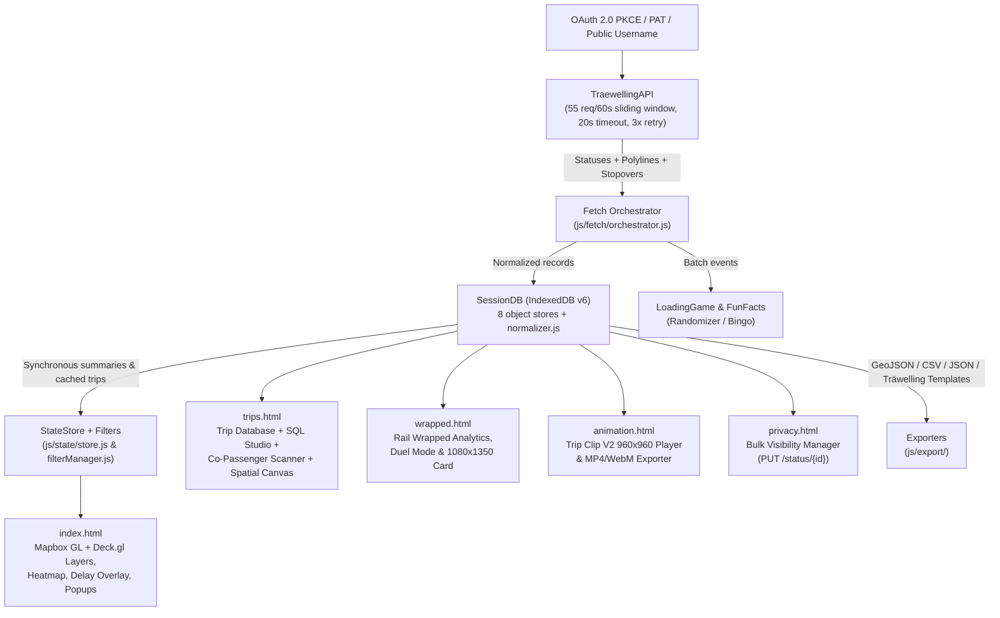

# Träwelling Map Explorer — Current State Specification (`spec.md`)

> Single source of truth documenting the current **As-Is** architecture, modules, data schemas, API contracts, working features, and technical debt of **Träwelling Maps** (`traewelling-maps`).

---

## 1. Project Overview & Purpose

**Träwelling Map Explorer** is a client-side, multi-page web application for visualizing, querying, analyzing, animating, exporting, and managing check-in history from [Träwelling](https://traewelling.de/).

### Core Value Proposition
- **Zero-Backend Exploration**: Runs entirely in the user's browser with no build step and no intermediary server; all Träwelling API calls go directly from the browser to `https://traewelling.de/api/v1`.
- **Zero-Auth Public Discovery + Private Write Support**: Any public profile can be explored immediately by username; connecting via OAuth 2.0 PKCE or a Personal Access Token (PAT) unlocks private check-ins, live token-owner session metadata, and bulk visibility editing.
- **Instant Local Caching**: Uses a synchronous `localStorage` metadata cache paired with a multi-store IndexedDB database (`TraewellingMap`, schema v6, 90-day session expiration) to reload accounts instantaneously and perform incremental fetches.
- **Suite of 6 Integrated Views**: Combines a WebGL/Mapbox route map (`index.html`), a faceted Trip Database & in-browser SQL Studio (`trips.html`), annual Rail Wrapped analytics (`wrapped.html`), a 960×960 video clip generator (`animation.html`), a bulk Check-in Privacy Manager (`privacy.html`), and a searchable User Guide (`docs.html`).

### Target Users
- **Träwelling commuters & rail enthusiasts** wanting high-resolution interactive maps of their check-in history beyond built-in profile views.
- **Data-oriented travelers & civic transit mappers** needing rich GeoJSON (with optional intermediate stopovers), CSV/JSON exports, or ad-hoc SQL queries over personal travel logs.
- **Social sharers & privacy-conscious users** creating Rail Wrapped summary cards / MP4 & WebM trip clips or auditing/locking check-in visibility in bulk.

---

## 2. Tech Stack & Architecture

### Runtime Stack
- **Application Model**: Static, zero-build, multi-page vanilla ESNext (`"type": "module"`, target `ES2022`) served directly from the repository root (deployed via GitHub Pages).
- **Mapping & Geospatial Rendering (`index.html` CDN dependencies)**:
  - `mapbox-gl@2.11.0` (`mapbox-gl.js` / `mapbox-gl.css`) — Base vector map (`mapbox://styles/mapbox/dark-v10`), category GeoJSON `LineString` layers, interactive route popups, and optional OpenRailwayMap raster tile overlay.
  - `deck.gl@9.0.16` (`dist.min.js`) — Interleaved/overlay WebGL2 layers via `deck.MapboxOverlay` for route density heatmap/animation and delay overlay segments.
  - `@turf/turf@6.5.0` (`turf.min.js`) — Client-side geospatial computations.
  - *Zero-CDN Secondary Views*: `trips.html`, `wrapped.html`, `animation.html`, and `privacy.html` have zero external JavaScript runtime dependencies and render custom canvases/SVGs natively (`docs.html` loads Google Fonts stylesheets only).
- **Client Persistence**:
  - **IndexedDB (`TraewellingMap`, `VERSION: 6`)**: 8 object stores (`sessions`, `stopovers`, `polylines`, `stations`, `trips`, `statuses`, `co_passengers`, `geojson_cache`) managed by `SessionDB` (`js/cache/session.js`).
  - **Web Storage (`Storage` in `js/storage/storage.js`)**: `localStorage` for tokens, preferences, studio modes, scan watermarks, and synchronous session metadata (`tw_cached_sessions_meta`), `sessionStorage` for ephemeral OAuth PKCE state/verifier, plus an in-memory `Map` fallback when browser storage is restricted.
- **State Management**:
  - Central reactive pub/sub singleton `StateStore` (`js/state/store.js`, re-exported with compat init in `js/state/state.js`) exposed on `store` and mirrored to `window.state` / `window.store` on `index.html`.
  - Secondary views (`trips`, `wrapped`, `animation`, `privacy`) manage page-local module state backed directly by `SessionDB`, `Storage`, and URL query parameters (`?user=`, `?year=`, `?trip=`/`?id=`, `?fixture=`, `?preview=`).
- **Styling Architecture**:
  - Dark-first design system (`color-scheme: dark`) anchored in `css/tokens.css` CSS custom properties (colors, gradients, radii, shadows, `--font-sans`, `--font-heading`, `--font-mono`) alongside per-view stylesheets (`css/*.css`) and critical inline `<style>` FOUC guards in HTML heads.
- **Dev Tooling & CI/CD** (dev-only; no runtime bundling):
  - **ESLint 9** (`eslint.config.js`), **Stylelint 16** (`.stylelintrc.json`), **Prettier 3** (`.prettierrc.json`), **TypeScript 7.0.2** (`tsc --noEmit -p jsconfig.json` with `allowJs: true`, `checkJs: false`), and **Vitest 2** (`tests/unit/`).
  - **GitHub Actions**: `.github/workflows/ci.yml` runs `npm run lint`, `npm run lint:css`, and `npm test` on Node 22 for pushes to `main` and PRs; `.github/workflows/pages.yml` deploys `.` directly to GitHub Pages on push to `main`.

### High-Level Data Flow

---

## 3. Folder & File Structure

Root contains 7 HTML entry points, project configs, favicons, and CI metadata, plus CSS, JS, and test directories:

| Path | Purpose |
| :--- | :--- |
| `index.html` | Interactive route map explorer (Mapbox GL JS + Deck.gl + setup modal + layer/search/stats drawers) |
| `trips.html` | Faceted Trip Database Explorer, SQL Studio workbench, co-passenger scanner, and spatial canvas preview |
| `wrapped.html` | Annual / all-time Rail Wrapped dashboard, traveler comparison ("Duel Mode"), and PNG share card modal |
| `animation.html` | Trip Clip V2 (`960×960` `@ 30fps`) interactive player and deterministic MP4/WebM video exporter |
| `privacy.html` | Check-in Privacy Manager for inspecting and bulk-updating visibility (`0`–`5`) via API |
| `docs.html` | Static interactive User Guide & SQL schema reference with live section search (`/` shortcut) |
| `css/` *(13 files)* | Design tokens (`tokens.css`), shared base rules (`base.css`, `styles.css`), and page/widget stylesheets (`map-ui.css`, `cargo-animation.css`, `fun-facts.css`, `loading-game.css`, `trips.css`, `wrapped.css`, `animation.css`, `animation-v2.css`, `privacy.css`, `docs.css`) |
| `js/app.js` | Main map bootstrap (`initApp`), OAuth callback check, `#map=z/lat/lng` hash jump, `?user=`/`?trip=` quick-load, `?preview=` harness, `window.*` compatibility bridge |
| `js/config/config.js` | `@ts-check` `CONFIG` + `resolveMapStyle()`: Mapbox token, self-hostable tokenless raster tile fallback (`carto-dark`, `osm`, `custom`), `API_BASE_URL`, rate limit (`55/60000ms`), 90-day session TTL, OAuth PKCE client ID (`419`), `LAYER_CONFIG` |
| `js/types.d.ts` | Shared TypeScript interfaces for upstream Träwelling payloads, relational records, cached sessions, filters, and `AppState` |
| `js/api/traewelling.js` | `TraewellingAPI` class: sliding-window rate limiter, `AbortController` 20s timeout, retry backoff, and endpoint wrappers |
| `js/storage/storage.js` | `STORAGE_KEYS` constants and safe `Storage` wrapper (`localStorage`, `sessionStorage`, in-memory `Map` fallback) |
| `js/cache/` | `session.js` (`SessionDB` IndexedDB v6 manager + v4 migration + 15-session LRU/expiry) and `normalizer.js` (`@ts-check` entity normalization/denormalization) |
| `js/session/` | `manager.js` (multi-account switching, profile fetch, token validation/logout) and `oauth.js` (PKCE S256 verifier/challenge & token exchange) |
| `js/state/` | `store.js` (`StateStore` pub/sub store) and `state.js` (initialization compatibility helper) |
| `js/data/processing.js` | Transport category normalization (11 categories + `unknown`), accuracy heuristics (`filterLevel` 0/1/2), search corpus builder, tag extraction, GeoJSON binning |
| `js/fetch/orchestrator.js` | Multi-page API fetcher, automatic incremental stop-at-watermark fetching, batch stopovers/polylines, wake lock, cargo depot UI updates |
| `js/filters/filterManager.js` | Sequential trip filter pipeline: date range → business type → buddies/mentions → search → polyline accuracy |
| `js/analytics/statistics.js` | Map-view aggregate stats (trip counts, distance, top lines/modes, oldest/newest dates, travel buddy extraction) |
| `js/export/` | `geojson.js` (GeoJSON/CSV/JSON import & export + optional stopover enrichment) and `manualTrip.js` (Träwelling Manual Trip CSV importer & JSON template export) |
| `js/map/` | `interactions.js` (Mapbox + Deck init, popups, media viewer), `layers.js` (category layer order/toggles), `heatmap.js`, `delayOverlay.js`, `routeAnimation.js`, `tripCycler.js` (deep-link focus) |
| `js/events/listeners.js` | DOM event bindings, debounced filter handlers, setup/menu controls, disabled share button stub |
| `js/ui/` | `ui.js` (setup screen, cargo animation, banners, wake lock), `navigation.js` (`?user=` cross-link sync), `rateLimit.js`, `tripDetails.js`, `funFacts.js`, `loadingGame/` (`index.js`, `checkinRandomizer.js`) |
| `js/trips/` | `app.js` (Trip Explorer + Studio controller), `sqlEngine.js` (in-memory SQL parser/evaluator & `QUERY_RECIPES`), `sqlAutocomplete.js`, `coPassengerScanner.js`, `formatters.js` (`hasJourneyOverlap`, `renderLinkedComment`), `mapPreview.js` (`SpatialMapPreview` canvas) |
| `js/wrapped/` | `app.js` (Rail Wrapped controller & Duel Mode), `analytics.js` (`calculateWrappedInsights`, `sanitizeTripDistanceKm`, `compareUsers`), `socialCard.js` (1080×1350 PNG generator) |
| `js/anim-v2/` | `app.js` (Trip Clip V2 controller), `precompute.js` (1,000-sample `Float32Array` trajectory/camera LUTs & analytical spring), `player.js`, `renderer.js`, `export.js` (`VideoClipExporterV2`) |
| `js/animation/` | Shared animation primitives (`geometry.js`, `tiles.js`, `timeframe.js`, `vectorData.js`, `vectorRenderer.js`, `webmFixer.js`, `renderer.js` shared by `js/anim-v2/`) |
| `js/privacy/` | `app.js` (bulk check-in visibility UI & API updater) and `visibility.js` (`VISIBILITY_LEVELS` `0`–`5`, lock guard, filters) |
| `js/docs.js` | User Guide smooth-scroll spy, copy-to-clipboard buttons, search filter, keyboard `/` & `Escape` handlers |
| `js/utils/` | `color.js`, `data.js`, `format.js`, `geometry.js`, `logger.js`, `math.js`, `time.js` |
| `tests/unit/` *(24 files)* | Vitest suites covering storage, IndexedDB normalization, incremental fetch, SQL engine, privacy visibility, Wrapped analytics, Trip Clip precompute/export/tiles/timeframe/WebM fixer, and map logic |
| `tests/e2e/` *(10 scripts + `screenshots/`)* | Node E2E & stress test scripts (including instant-boot benchmark, relational studio, and mobile visual checks) |
| `.github/` | CI workflow (`ci.yml`), Pages deployment (`pages.yml`), issue/PR templates |
| `.agents/skills/` | Repo-local agent skills (`continuous-qa-visual-auditor`, `no-build-modernizer`) |

---

## 4. Current Features (As-Is State)

### Interactive Map Explorer (`index.html` + `js/app.js`)
- **Authentication & Onboarding**:
  - **Public Mode**: Load any Träwelling username without credentials.
  - **OAuth 2.0 PKCE (`js/session/oauth.js`)**: Uses S256 code challenge (`CLIENT_ID: '419'`, scopes `read-statuses read-statistics`), warns if host is not `localhost`, `127.0.0.1`, `192.168.1.26`, or `fabian-c.github.io`, and exchanges `?code=` automatically on boot.
  - **Personal Access Token (PAT)**: Manual paste input with 1-click clipboard button (`pasteTokenBtn`), auto-validated against `/auth/user` on startup.
- **Session Caching & Incremental Fetching (`js/fetch/orchestrator.js`)**:
  - Instant account switching from `tw_cached_sessions_meta` (sync `localStorage`) and full trip hydration from `SessionDB` (up to 15 sessions, 90-day TTL).
  - Automatic incremental fetch when reloading a cached username unless Shift-click (`forceFresh: true`) is used; requests intermediate stopovers (`GET /stopovers/{ids}`) if enabled.
  - Live depot progress UI with cargo animation, Web Wake Lock acquisition while visible, `FunFacts`, and `LoadingGame` (`CheckinRandomizer`, which launches minimized by default on small screens `<= 768px`).
- **Map Layers, Filtering & Visualizations**:
  - **12 Transit Categories (`CONFIG.LAYER_CONFIG`)**: `nationalExpress`, `regionalExp`, `national`, `regional`, `suburban`, `bus`, `tram`, `subway`, `taxi`, `plane`, `ferry` (merging legacy `ship`), and `unknown`. Toggle visibility and drag/reorder layers (persisted to `tw_layer_order`).
  - **Polyline Accuracy Filter (`js/data/processing.js`)**: Levels `0` (All/relaxed), `1` (Normal/default, filters short straight-line approximations using segment count/length thresholds), `2` (Strict, also drops `>70%` single-segment jumps or outlier segments `>40x` median). Non-plane/ferry flights bypass distance pruning; geometry-less check-ins are still retained in statistics.
  - **Faceted Filters (`js/filters/filterManager.js`)**: Date range (`fromDate`/`toDate`), business type (`personal`, `work`, `commute`), multi-buddy filter with toggleable `@mention` body parsing, and freetext corpus search (covering line, stations, stopovers, notes, tags/seats/wagons/locomotives).
  - **Overlays**: OpenRailwayMap infrastructure raster layer (`https://a.tiles.openrailwaymap.org/standard/{z}/{x}/{y}.png`), Deck.gl route density heatmap with optional particle animation (`RouteAnimation`), and Deck.gl delay overlay (`delays.enabled`, highlights top worst-delayed routes >= 3 min; mutually exclusive with heatmap).
- **Deep Linking, Popups & Data Import/Export**:
  - Supports `#map=zoom/lat/lng`, `?user=`, `?trip=`/`?id=`/`?statusId=`/`?status=`, `?preview=fetch|layers|search|stats`, and built-in `SAMPLE_FIXTURE_TRIPS` demo fallback (`resu`).
  - Interactive route popups display schedule vs. actual delays, platform/seat/wagon/tag badges, linked notes, travel buddies, and media.
  - Import/export GeoJSON (with optional stopover enrichment), CSV, JSON, and Träwelling manual trip templates.

### Trip Database Explorer & SQL Studio (`trips.html` + `js/trips/`)
- **Standard Mode (`appMode: 'standard'`)**:
  - Paginated (100 rows/page) sortable table with search, category chips, year pills, delay filter, buddy selector, travel purpose filter, inline expandable journey details, and detail modal ("Enrich from Träwelling" fetches fresh status/stopovers/polyline via API).
  - Telemetry bar displays matched trip count, distance, and rail duration (toggleable standard / days / months).
  - Links directly into `index.html` (`View on Map`) or `animation.html` (`Animate`).
- **Incremental Co-Passenger Scanner (`js/trips/coPassengerScanner.js`)**:
  - Scans trips newest-first against `GET /trips/{tripId}/statuses`, stores upstream results in IndexedDB (`co_passengers` store), tracks per-user scan watermarks in `localStorage` (`tw_copassengers_watermark_<user>`), and applies `hasJourneyOverlap()` before attributing companions.
- **Database Studio Mode (`appMode: 'studio'`)**:
  - Lazy-loads `sqlEngine.js` and `sqlAutocomplete.js`. Supports `unified` (`trips` view) and `raw` (`statuses`, `stations`, `routes`, `co_passengers` views backed by `SessionDB`), `SELECT DISTINCT`, `AVG`/`SUM`/`MIN`/`MAX`/`COUNT`, `AS` aliases, `NOT IN`, 15 built-in `QUERY_RECIPES`, schema explorer, context-aware autocomplete, CSV/JSON/GeoJSON export of query results, and collapsible interactive `SpatialMapPreview` canvas over `VECTOR_COUNTRIES`.

### Rail Wrapped (`wrapped.html` + `js/wrapped/`)
- **Metrics & Distance Sanitization (`js/wrapped/analytics.js`)**:
  - Year selector (`All-Time` + extracted years) and profile switcher; updates rendered DOM using `document.startViewTransition` when available.
  - `sanitizeTripDistanceKm()` rejects anomalous upstream distance spikes (`> 3× Haversine + 50 km` or exceeding mode ceilings) by falling back to geodesic Haversine distance (`× 1.15` rail detour factor).
  - Computes total trips, km, Earth circumferences (`40,075 km`), Moon distance `%` (`384,400 km`), hours, unique stations visited, punctuality rate & delay tiers (`<=5m`, `6-15m`, `16-30m`, `>30m`), Delay Hall of Fame, 7×24 activity heatmap, top arrival stations, category breakdown, and top overlapping companions.
- **Duel Mode & Social Card Export**:
  - `compareUsers()` compares metrics head-to-head against a second cached profile or fetched public user.
  - `generateWrappedCardCanvas()` renders a `1080×1350` (4:5) PNG card (`<dialog>` preview modal) with PNG download and `navigator.share` fallback.

### Trip Clip V2 Animation Studio (`animation.html` + `js/anim-v2/`)
- **Single-Trip & Timeframe Montage Modes (`js/animation/timeframe.js`)**:
  - Animate one selected check-in or an entire filtered timeframe (`all`, `today`, `last-7-days`, `this-week`, `last-week`, `this-month`, `last-30-days`, `this-year`, `custom` date/time range).
  - External guest isolation: `?trip=` deep links can fetch and play/export a public check-in via `/status/{id}` & `/polyline/{id}` without polluting cached sessions.
- **Playback & Styles (`js/anim-v2/player.js`, `js/animation/tiles.js`)**:
  - 960×960 `@ 30fps` offscreen precomputed 1,000-sample `Float32Array` LUTs (`posLUT`, `angleLUT`, `camTargetLUT`) and analytical damped spring camera/badge animations (`computeSpring`).
  - Supports 9 distinct map styles in `MAP_STYLES` (7 Mapbox/OSM/Cyclosm/ArcGIS raster styles with CORS fallbacks + `vector-dark` / `vector-light` via `vectorData.js`, plus a `vector` alias).
- **Deterministic Offline Video Export (`js/anim-v2/export.js`)**:
  - Renders frame-by-frame to an offscreen canvas (`captureStream(0)` + `requestFrame()` at 10 Mbps), preferring `video/mp4;codecs=avc1` / `video/mp4` with automatic fallback to `video/webm` patched via `fixWebMBlob()` (`js/animation/webmFixer.js`) for seekable duration metadata.

### Check-in Privacy Manager (`privacy.html` + `js/privacy/`)
- Inspects local cached check-ins or fetches up to `maxPagesSelect` (JS default fallback `50`) pages from `/auth/user` + `/user/{username}/statuses` using a Träwelling PAT.
- Displays counts across `VISIBILITY_LEVELS` `0`–`5` (`Public`, `Unlisted`, `Followers only`, `Private`, `Logged-in users`, `Trusted users`) plus locked check-ins (`lock_visibility` guard prevents selecting/mutating locked statuses).
- Filters by visibility, date range, and text query; supports page/batch selection and rate-limited sequential `PUT /status/{id}` updates with pause/cancel and automatic `SessionDB` write-back.

### Documentation & Cross-Navigation (`docs.html` + `js/docs.js`, `js/ui/navigation.js`)
- Live search (`/` hotkey), sticky section navigation (`IntersectionObserver`), code copy buttons, and consistent `?user=` propagation across internal `.html` header links (`syncNavigationLinks`).

---

## 5. Data Models & API Interfaces

### IndexedDB (`TraewellingMap`, `VERSION: 6`, `js/cache/session.js`)

| Object Store | `keyPath` | Indexes | Purpose / Retained Scope |
| :--- | :--- | :--- | :--- |
| `sessions` | `username` | — | Account session metadata (`displayName`, `avatar`, `tripCount`, `token`, `timestamp`), max 15 sessions, 90-day TTL |
| `stopovers` | `statusId` | — | Cached intermediate stopover arrays per check-in status ID |
| `polylines` | `statusId` | — | Decoded GeoJSON `Feature` route geometries keyed by status ID |
| `stations` | `id` | `name` | Normalized station nodes (`id`, `name`, `latitude`, `longitude`, `eva_number`, `country_code`) |
| `trips` | `id` | `category` | Normalized transit line runs (`backend_trip_id`, `line_name`, `train_number`, `category`, `operator_name`, origin/dest IDs, `polyline`) |
| `statuses` | `id` | `username`, `username_departure` (`['username','departure_time']`), `departure_delay` | Normalized check-in facts (times, platforms, delays, `distance_km`, `duration_min`, `business_type`, `visibility`, `buddies`, `co_passengers`) |
| `co_passengers` | `trip_id` | `trip_id` | Cached `/trips/{tripId}/statuses` co-passenger arrays scanned incrementally |
| `geojson_cache` | `username` | — | Pre-materialized category GeoJSON cache per user (invalidated on `SessionDB.save` when omitted) |

### Storage Keys (`STORAGE_KEYS` in `js/storage/storage.js` + Dynamic Watermarks)
- `localStorage`: `tw_token`, `tw_auth_method`, `tw_fetch_stopovers`, `tw_filter_level`, `tw_include_notes`, `tw_layer_order`, `tw_studio_table_mode`, `tw_cached_sessions_meta`, `tw_cached_sessions_data`, plus `tw_copassengers_watermark_<username>` (`js/trips/coPassengerScanner.js`).
- `sessionStorage`: `tw_oauth_verifier`, `tw_oauth_state`.

### TypeScript Interfaces (`js/types.d.ts`)
- **Upstream API**: `TraewellingUser`, `TraewellingStation`, `TraewellingOperator`, `TraewellingStopover`, `TraewellingTrain`, `TraewellingStatus`.
- **Companions**: `CoPassenger`, `TravelBuddy`.
- **Relational Store**: `NormalizedStation`, `NormalizedTripRun`, `NormalizedStatus`, `CachedSessionSummary`, `CachedSession`.
- **Store / Filters**: `TokenOwner`, `FilterState`, `AppState`.

### Träwelling API & OAuth Endpoints
Base URL: `https://traewelling.de/api/v1` (`TraewellingAPI` enforces `55` requests / `60,000 ms`, `20s` request timeout, `3` retries with exponential backoff / `Retry-After` handling on HTTP `429`/`5xx`).

| Method & Path | Auth Required | Client Caller(s) | Purpose |
| :--- | :--- | :--- | :--- |
| `GET /user/{username}` | Optional | `TraewellingAPI.getPublicUser`, `fetchUserProfile` | Public profile summary & stats |
| `GET /user/{username}/statuses?page={p}` | Optional | `TraewellingAPI.getUserStatuses` | Paginated check-in feed |
| `GET /status/{id}` | Optional | `TraewellingAPI.getStatus` | Single check-in lookup (enrichment & guest clip playback) |
| `PUT /status/{id}` | Required (`Bearer`) | `TraewellingAPI.updateStatus` (`privacy.html`) | Update check-in `visibility` (`0`–`5`) |
| `GET /polyline/{id[,ids...]}` | Optional | `TraewellingAPI.getPolyline`, `getPolylines` | Single or comma-joined batch route geometries |
| `GET /stopovers/{id[,ids...]}` | Optional | `TraewellingAPI.getStopovers` | Comma-joined batch intermediate station stopovers |
| `GET /trips/{tripId}/statuses` | Optional | `TraewellingAPI.getTripStatuses` | Co-passengers who checked into the same upstream train run |
| `GET /auth/user` | Required (`Bearer`) | `TraewellingAPI.getAuthenticatedUser` | Validate token owner identity |
| `GET https://traewelling.de/oauth/authorize` | Public browser nav | `OAuth.startLogin` | PKCE `S256` authorization request (`client_id=419`) |
| `POST https://traewelling.de/oauth/token` | PKCE `code_verifier` | `OAuth.checkForCallback` | Exchange authorization code for bearer token |

### In-Memory SQL Studio Tables & Grammar (`js/trips/sqlEngine.js`)
- **Exposed Schemas (`TABLE_SCHEMAS`)**:
  - `trips` *(18 schema columns)*: `id`, `line`, `category`, `origin`, `destination`, `departure`, `arrival`, `year`, `delay_dep`, `delay_arr`, `distance_km`, `duration_min`, `operator`, `business`, `backend_trip_id`, `buddies`, `buddy_count`, `notes` (plus `flattenTripRecord` aliases `buddies_count` and `_rawTrip`).
  - `statuses` *(14 columns)*, `stations` *(6 columns)*, `routes` *(7 columns)*.
- **Supported Grammar**: `SELECT [* | cols | COUNT(*)] [FROM table] [WHERE predicate] [ORDER BY col [ASC|DESC], ...] [LIMIT n] [OFFSET n]`, with `AND`, `OR`, `NOT`, `(...)`, `=`, `!=`/`<>`, `>`, `<`, `>=`, `<=`, `LIKE`, `ILIKE`, `IN (...)`, `BETWEEN ... AND ...`, `IS [NOT] NULL`.

---

## 6. Known Issues & Technical Debt

1. **SQL `JOIN` & `GROUP BY` Not Yet Implemented (`js/trips/sqlEngine.js`)**:
   - `sqlEngine.js` now supports `SELECT DISTINCT`, `AVG`/`SUM`/`MIN`/`MAX`/`COUNT`, `AS` aliases, `NOT IN`, and the `co_passengers` table, while multi-table `JOIN` and `GROUP BY` grouping remain unimplemented.
2. **OAuth Client Coupling (`js/config/config.js`)**:
   - `CONFIG.OAUTH.CLIENT_ID: '419'` restricts OAuth logins to pre-registered redirect domains, forcing PAT fallback on forks or unlisted hosts. (Mapbox tiling now supports tokenless `carto-dark`, `osm`, and `custom` raster tile fallbacks via `resolveMapStyle()`.)
3. **Hidden Share View Feature (`index.html:882`, `js/events/listeners.js:324`)**:
   - `#shareBtn` remains intentionally hidden/commented out in `index.html` while its click binding (`if (shareBtn) shareBtn.onclick = shareView`) stays wired in `listeners.js`.
4. **Partial `@ts-check` Coverage (`jsconfig.json`)**:
   - Core modules (`config.js`, `visibility.js`, `traewelling.js`, `format.js`, `sqlEngine.js`, `analytics.js`, `normalizer.js`, `formatters.js`) have `// @ts-check` enabled, while UI/map modules remain untyped with `checkJs: false`.
5. **Sequential E2E Execution & CI Scope**:
   - `npm run test:e2e` executes 4 Node scripts sequentially, each spawning its own headless Chromium instance; `.github/workflows/ci.yml` runs unit tests and linters only (no automated E2E or `npm run format` check in CI).

---

## 7. Roadmap (Next Steps)

- [x] **Remove CO₂ Emissions Stats**: Removed inconsistent CO₂ calculations/KPIs across `trips.html`, `wrapped.html`, and `socialCard.js` (replaced with `Stations Visited` in Wrapped).
- [x] **Expand SQL Studio Engine**: Implemented `SELECT DISTINCT`, `AVG`/`SUM`/`MIN`/`MAX`, `AS` aliases, `NOT IN`, and queryable `co_passengers` table.
- [x] **Retire Legacy Animation V1 & DelayBingo**: Removed `animation-v2.html`, `js/animation/recorder.js`, `delayBingo.js`, and legacy tests; `CheckinRandomizer` now launches minimized on small screens (`<= 768px`).
- [x] **Hygiene, Self-Hosted Tiling & CSS Cleanup**: Eliminated all 26 Stylelint `!important` warnings, added `resolveMapStyle()` for tokenless/self-hosted raster tiles, added `// @ts-check` to core modules, and synced `README.md` / `CONTRIBUTING.md`.
- [ ] **Optional Future Enhancements**: Add `GROUP BY` / `JOIN` to `sqlEngine.js`, extract a shared browser pool helper for `tests/e2e/`, and add `npm run format` to `.github/workflows/ci.yml`.
